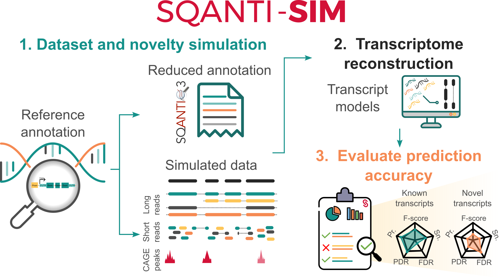

<p align="center">
  
</p>

<p align="center">
  <a href="https://github.com/ConesaLab/SQANTI-SIM/wiki/Requirements-and-installation">Installation</a>
  ·
  <a href="https://github.com/ConesaLab/SQANTI-SIM/wiki">Documentation</a>
  ·
  <a href="https://github.com/ConesaLab/SQANTI-SIM/issues">Report bug</a>
  ·
  <a href="https://github.com/ConesaLab/SQANTI3">SQANTI3</a>
</p>

***

SQANTI-SIM is an open-source long-read RNA-seq (LRS) simulation tool designed to generate high-fidelity ONT and PacBio transcriptome long reads with precise control over transcript novelty based on [SQANTI3](https://github.com/ConesaLab/SQANTI3) structural categories, along with  orthogonal data supporting both known and novel transcripts.

By building upon the capabilities of [NanoSim](https://github.com/bcgsc/NanoSim), [PBSIM3](https://github.com/yukiteruono/pbsim3), and [IsoSeqSim](https://github.com/yunhaowang/IsoSeqSim) to simulate long reads using the provided GTF, SQANTI-SIM generates both simulated reads and a reduced GTF with excluded transcripts flagged as novel. Additionally, SQANTI-SIM goes a step further by generating matching Illumina and CAGE data for the simulated LRS, thus faithfully reproducing LRS transcriptome datasets.



## Documentation

Please refer to [Wiki](https://github.com/ConesaLab/SQANTI-SIM/wiki) for how to install and use SQANTI-SIM:

- [Overview](https://github.com/ConesaLab/SQANTI-SIM/wiki/Overview)

- [Requirements and installation](https://github.com/ConesaLab/SQANTI-SIM/wiki/Requirements-and-installation)

- [Parameters summary](https://github.com/ConesaLab/SQANTI-SIM/wiki/Parameters-summary)

- [Run SQANTI-SIM](https://github.com/ConesaLab/SQANTI-SIM/wiki/Run-SQANTI-SIM)

- [SQANTI-SIM: classif](https://github.com/ConesaLab/SQANTI-SIM/wiki/SQANTI-SIM:-classif)

- [SQANTI-SIM: design](https://github.com/ConesaLab/SQANTI-SIM/wiki/SQANTI-SIM:-design)

- [SQANTI-SIM: sim](https://github.com/ConesaLab/SQANTI-SIM/wiki/SQANTI-SIM:-sim)

- [Tutorial](https://github.com/ConesaLab/SQANTI-SIM/wiki/Tutorial)

## Running Parallel Jobs

SQANTI-SIM supports running multiple simulation jobs in parallel. To avoid potential race conditions when multiple jobs access the same genome file simultaneously, **pre-create the genome index file** before launching parallel jobs:

```bash
# Pre-create the .fai index file
samtools faidx genome.fa

# Example: Run parallel jobs with different simulators or parameters
# Job 1: PBSIM3 simulation
python sqanti-sim.py sim --pbsim \
    --genome genome.fa \
    --gtf annotation.gtf \
    --trans_index index.tsv \
    --dir output_pbsim \
    --cores 1 &

# Job 2: NanoSim ONT simulation
python sqanti-sim.py sim --ont \
    --genome genome.fa \
    --gtf annotation.gtf \
    --trans_index index.tsv \
    --dir output_ont \
    --read_type cDNA &

# Job 3: Different expression profile
python sqanti-sim.py sim --pbsim \
    --genome genome.fa \
    --gtf annotation.gtf \
    --trans_index index_high_expression.tsv \
    --dir output_high_expr \
    --cores 1 &

wait  # Wait for all jobs to complete
```

This ensures that all temporary files are properly isolated in job-specific directories and prevents file collisions between parallel jobs.

## Change Log

Current version (25/07/2024): **0.3.0**

Updates, patches and releases:

- [Change log](https://github.com/ConesaLab/SQANTI-SIM/wiki/Change-Log)

## How to cite SQANTI-SIM

Please cite the following [publication](https://doi.org/10.1186/s13059-023-03127-0) if you're using SQANTI-SIM in your research:

- Mestre-Tomás, J., Liu, T., Pardo-Palacios, F., & Conesa, A. (2023). SQANTI-SIM: a simulator of controlled transcript novelty for lrRNA-seq benchmark. *Genome Biology, 24*(1), 286. https://doi.org/10.1186/s13059-023-03127-0
